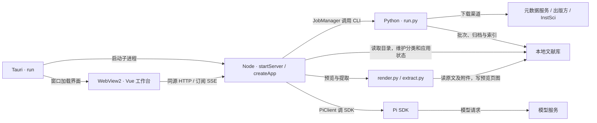

# Zhiyue 架构

## 1. 系统概览

Zhiyue 是面向个人研究者的 Windows 桌面文献工作台。用户可导入本地 PDF，按 DOI 或题名获取论文，浏览原文与笔记，或带着所选论文和附件向 Pi Agent 提问。应用生成带固定 L 编号的归档、来源记录、文献索引、阅读标记和聊天记录。PDF 渲染与核验使用本机 Python 和 Poppler。联网下载由文献工具访问元数据服务、出版方及机构渠道，问答由 Pi SDK 访问用户配置的模型服务。更新由桌面壳访问配置的更新源。操作说明见 [项目 README](README.md) 和 [桌面界面与本地服务](app/web/README.md)。

## 2. 代码地图

1. 本机构建后运行 [start-desktop.cmd](start-desktop.cmd)，源码调试用 `npm run desktop:dev`。Tauri 的 `main → run` 注册窗口、托盘、单实例与更新插件，再调用 `spawn_sidecar`。打包版从随包资源定位 Node，调试版从本机 PATH 查找 Node。[启动命令](package.json) · [Rust 入口](app/desktop/src-tauri/src/main.rs) · [Tauri 进程管理](app/desktop/src-tauri/src/lib.rs)
2. `startServer` 初始化文献库，在 `127.0.0.1` 的系统分配端口上监听，通过标准输出的 `ZHIYUE_URL=` 交接地址。Tauri 收到地址后导航到 `/`，由 Node 提供 `public/index.html` 和 `/js/app.js`。启动超时或握手前进程退出会在启动页显示错误。[Node 入口](app/web/src/server.mjs) · [启动页](app/desktop/frontend/index.html) · [挂载页](app/web/public/index.html)
3. `mountWorkspace` 挂载 Vue 主界面，调用 `workspace.start` 拉取文献、会话和任务，并用 `EventSource` 订阅 `GET /api/events`。[Vue 入口](app/web/frontend/main.js) · [界面状态](app/web/frontend/lib/workspace.js)

| 要改的内容 | 从这里读 |
| --- | --- |
| 窗口、托盘、退出、启动失败 | `run`、`resolve_launch`、`spawn_sidecar` 和 `stop_sidecar` 管理 Tauri 窗口与 Node 子进程。关闭窗口隐藏到托盘，应用退出时清理子进程。更新由 `check_updates` 处理。[lib.rs](app/desktop/src-tauri/src/lib.rs) · [update.rs](app/desktop/src-tauri/src/update.rs) |
| 面板结构、表单、选择状态、样式 | `Workspace.vue` 装配各面板，`createWorkspace` 持有响应式状态并消费 HTTP/SSE。PDF 阅读器的页节点与缩放由 `createReader` 管理。[Workspace.vue](app/web/frontend/Workspace.vue) · [workspace.js](app/web/frontend/lib/workspace.js) · [reader.js](app/web/frontend/lib/reader.js) · [styles.css](app/web/public/css/styles.css) |
| API、附件、静态资源与事件 | `createApp` 装配 `Library`、`JobManager` 和 `AssistantService`，集中注册 `/api/` 路由。`checkRequest` 校验本机请求，`emit` 向 SSE 连接推送任务和聊天事件。[server.mjs](app/web/src/server.mjs) |
| 文献列表、分类、阅读标记、PDF 预览 | `Library.getLibrary` 将索引、分类目录、笔记与用户阅读状态组合成界面数据。`safeFile` 校验可读文件，`previewPaper` 调用 `render.py` 并缓存页图和文字层。[library.mjs](app/web/src/lib/library.mjs) · [preview.mjs](app/web/src/lib/preview.mjs) · [render.py](app/web/src/lib/render.py) |
| 导入、下载、归档 | `JobManager` 管理排队、日志和子进程。`run.py:main` 也供独立 CLI 使用，派发批次、渠道、核验与归档操作。新增下载渠道从 `workflow.download` 和 `providers/` 入手，编号与版本规则在 `archiving.archive`。[jobs.mjs](app/web/src/lib/jobs.mjs) · [run.py](app/downloader/run.py) · [workflow.py](app/downloader/workflow.py) · [归档逻辑](app/downloader/archiving.py) · [CLI 说明](app/downloader/README.md) |
| 助手消息、文献工具、模型与密钥 | `ChatService` 持有聊天、活动回答和草稿。`AssistantService` 注册 `dynamicTools` 并提供 Pi 设置接口。`PiClient` 在 Node 进程内加载 SDK、管理模型和会话，并把 SDK 事件转成应用事件。[chat.mjs](app/web/src/lib/chat.mjs) · [assistants.mjs](app/web/src/lib/assistants.mjs) · [pi.mjs](app/web/src/lib/pi.mjs) |

依赖图中的箭头表示启动、调用或文件读写。应用状态随文献库存放，Pi 的全局模型与密钥配置使用本机 Pi 配置目录。[文献库布局](app/web/src/lib/paths.mjs) · [PiClient.start](app/web/src/lib/pi.mjs)

## 3. 核心流程

### 本地 PDF 从导入到出现在列表

1. `ImportPaperDialog.submit` 校验书目表单和核对勾选，逐个调用 `workspace.uploadFile`。`POST /api/uploads` 校验扩展名、大小和 PDF 文件头，把内容写到 `.zhiyue/data/uploads/` 并在 `.zhiyue/data/uploads.json` 登记，返回上传 ID。随后 `workspace.importPdfs` 发 `POST /api/library/import`，携带上传 ID、书目信息和分类。服务端按 ID 查找已登记文件。[导入对话框](app/web/frontend/components/ImportPaperDialog.vue) · [workspace.js](app/web/frontend/lib/workspace.js) · [server.mjs](app/web/src/server.mjs)
2. `JobManager.startLocalImports` 检查分类、上传位置和元数据，对当前批次和索引记录中的主文件做 SHA-256 查重。部分重复时跳过对应项，全部跳过时返回 409。`_enqueue` 在 `.zhiyue/data/jobs.json` 持久化任务，接口以 202 返回 `{ job, skipped }`。后台队列顺序运行 `import → 每项 attach、review --accept-identity → 整批 archive`。身份确认来自前端勾选，提交载荷没有单独的确认字段，后台按此入口传入人工身份确认参数。[jobs.mjs](app/web/src/lib/jobs.mjs) · [server.mjs](app/web/src/server.mjs) · [导入和查重测试](app/web/test/jobs.test.mjs)
3. `run.py:main` 按批次加锁。`workflow.ingest` 把候选放到 `.zhiyue/tmp/`，用 `validation.verify` 检查身份、解析和首末页渲染，将结果写进 `.zhiyue/batches/<批次>/下载状态.json`。`archiving.archive` 持有目录写锁，检查身份、全页解析、首末页渲染及哈希，分配或复用 L 编号，保存原字节和同名 `.来源.json`，更新文献库 README、批次及由 `library.build` 生成的 `.zhiyue/catalog/文献索引.json` 等目录文件。未通过项留在批次，供人工处理或续跑。归档涉及多个文件，代码用备份、归档记录及逐项保存保留恢复线索。[run.py](app/downloader/run.py) · [workflow.py](app/downloader/workflow.py) · [validation.py](app/downloader/validation.py) · [batches.py](app/downloader/batches.py) · [archiving.py](app/downloader/archiving.py) · [索引构建](app/downloader/library.py)
4. `_enqueue` 从批次重新统计 `job.result.counts`。终态任务事件使服务侧 `Library.refresh` 清理缓存。导入对话框轮询 `GET /api/jobs/:id` 并重新读取 `GET /api/library`，通用工作区也处理 SSE 任务更新。以 `counts.archived` 判断归档数量，`completed` 仅表示命令流程结束。部分失败要查步骤日志与批次台账。[jobs.mjs](app/web/src/lib/jobs.mjs) · [server.mjs](app/web/src/server.mjs) · [导入对话框](app/web/frontend/components/ImportPaperDialog.vue) · [workspace.js](app/web/frontend/lib/workspace.js)

### Pi 问答从发送到保存结果

1. `Composer` 提交给 `workspace.sendMessage`，无会话时先 `POST /api/chats`，再 `POST /api/chats/:id/messages`。`ChatService.send` 按 chat ID 限制同一会话的活动回答，提交时保存用户消息及占位回答到 `.zhiyue/data/pi/chats.json`，并立即启动后台处理。HTTP 202 表示消息已接收，回答由异步事件返回。[Composer.vue](app/web/frontend/components/Composer.vue) · [workspace.js](app/web/frontend/lib/workspace.js) · [server.mjs](app/web/src/server.mjs) · [chat.mjs](app/web/src/lib/chat.mjs)
2. `ChatService.run` 新建或恢复 SDK 会话，保存关联的 `threadId`。SDK 会话文件位于 `.zhiyue/data/pi-sessions/`。`run` 用 `Library.getPaper` 读取选中文献的索引信息，用 `extractFile` 提取非图片附件的内容。图片由 `PiClient.runTurn` 读取并按模型能力附加到 `session.prompt`。需要读取论文正文时，SDK 工具经 `PiClient.callTool → ChatService.serverRequest` 进入 `read_paper_pages`，并通过 `Library.safeFile` 定位原文。模型服务会收到文献索引、附件内容及工具实际返回的正文片段。[chat.mjs](app/web/src/lib/chat.mjs) · [pi.mjs](app/web/src/lib/pi.mjs) · [server.mjs](app/web/src/server.mjs)
3. `PiClient.runTurn` 把 SDK 消息增量和结束状态转成通知。`ChatService.notification` 在内存更新增量，经 `GET /api/events` 发送 `delta`。消息或回答完成时写入聊天记录并推送 `message`。`createWorkspace` 内的 `receive` 合并事件，`syncChat` 用 HTTP 补查状态。停止请求进入 `ChatService.interrupt`，调用 SDK 的 `abort`。若轮次仍在启动，则等 ID 返回再中断。未配置模型或生成失败时，`finish` 记录失败状态。[pi.mjs](app/web/src/lib/pi.mjs) · [chat.mjs](app/web/src/lib/chat.mjs) · [workspace.js](app/web/frontend/lib/workspace.js) · [会话与停止测试](app/web/test/chat.test.mjs) · [Pi 适配测试](app/web/test/pi.test.mjs)
4. 如果模型调用 `draft_note`，`createNoteDraft` 先把草稿存在会话并发送预览事件。用户在界面选择保存或丢弃后，客户端调用 `POST /api/note-drafts/:id`，由 `resolveNoteDraft` 处理。保存时用独占创建写入 `notes/`，同名时另加序号。工作区随后刷新相关笔记。[chat.mjs](app/web/src/lib/chat.mjs) · [server.mjs](app/web/src/server.mjs) · [草稿测试](app/web/test/chat.test.mjs)

## 4. 架构约束与决策

| 修改时要守住的边界 | 现有保证与验证入口 |
| --- | --- |
| 桌面壳管理进程与窗口，Vue 通过本地 HTTP/SSE 使用业务能力 | Tauri 的 `run` 注册插件与窗口逻辑。主业务接口集中在 `createApp`，由本地服务校验 Host、Origin、跨站标记与请求类型。资料读取经 `Library.safeFile` 和真实路径检查。变更文件接口时保持索引和目录边界。[Tauri 权限](app/desktop/src-tauri/capabilities/default.json) · [server.mjs](app/web/src/server.mjs) · [HTTP 测试](app/web/test/server.test.mjs) · [资料边界测试](app/web/test/library.test.mjs) |
| 添加论文走 Python 归档，阅读标记走 Node | `archive` 在目录锁下保留原文和版本，编号在这里分配。`library.build` 从文献库 README 与来源记录生成索引。`Library.updatePaper` 只接受阅读状态和收藏字段，排队写入 `.zhiyue/data/reading.json`。分类重命名例外地由 `Library.renameCategory` 移动目录并同步已知引用。相关迁移须按团队约定一次性切换。[archiving.py](app/downloader/archiving.py) · [library.mjs](app/web/src/lib/library.mjs) · [归档与并发编号测试](app/downloader/tests/test_workflow.py) · [协作约定](AGENTS.md) |
| 任务队列、批次台账与归档文件是三类状态 | Node 的 `JobManager` 对应用任务串行调度并持久化，Python CLI 对批次操作加锁，归档另持目录写锁。进程重启时，Node 端排队中和运行中的任务会被标为失败并提示查看批次后续跑。Node 分类写队列与 Python 写锁各自维护，分类变更或新写入口涉及共同文件时要考虑并发顺序。[jobs.mjs](app/web/src/lib/jobs.mjs) · [library.mjs](app/web/src/lib/library.mjs) · [run.py](app/downloader/run.py) · [归档锁](app/downloader/archiving.py) |
| 模型能力由文献工具清单限定，正式笔记由用户定稿 | `AssistantService` 注册 `dynamicTools`，`PiClient.createSession` 使用应用提供的工具与资源加载器。新增工具在 `serverRequest` 校验输入后复用已有服务。保存行为由草稿确认端点触发。流式终态和停止时序有测试。[assistants.mjs](app/web/src/lib/assistants.mjs) · [pi.mjs](app/web/src/lib/pi.mjs) · [chat.mjs](app/web/src/lib/chat.mjs) · [会话与工具测试](app/web/test/chat.test.mjs) |

仓库中未找到独立 ADR。表中记录的是当前代码、测试或维护约定可确认的边界。保留本地 HTTP/SSE 的长期设计意图待维护者确认。

## 5. 构建、部署与排障

- `desktop:build` 先用 Vite 从 `frontend/main.js` 生成 `app/web/dist/app.js`，再由 `prepare-desktop.mjs` 准备 `resources/runtime/`，复制 Node、应用代码、文献库模板和 npm 运行依赖。Tauri 的 `frontendDist` 指向桌面启动页，`bundle.targets` 配置为 NSIS，发布资源随安装包交付。插入构建步骤时同时检查构建清单、启动路径和安装布局测试。[package.json](package.json) · [Vite 配置](app/web/vite.config.mjs) · [资源准备](app/scripts/prepare-desktop.mjs) · [Tauri 配置](app/desktop/src-tauri/tauri.conf.json)
- 排查“打开了另一份库”时，查 `GET /api/status` 的 `root` 与 `python`。源码调试默认用项目内 `library/`，安装版正常从系统文档目录定位 `Zhiyue/library`，`LITERATURE_LIBRARY` 可覆盖。`start-desktop.cmd` 默认显式指向项目库并优先使用项目虚拟环境。安装包内置 Node 与 Pi SDK，Python、Poppler、curl 和机构登录环境由本机提供。更新检查依赖运行时的 `ZHIYUE_UPDATE_ENDPOINT`，安装行为受 Tauri 的更新签名配置约束。正式更新源及其访问、签名和安装行为需在发布环境核验。[resolve_launch](app/desktop/src-tauri/src/lib.rs) · [paths.mjs](app/web/src/lib/paths.mjs) · [本机启动脚本](app/scripts/start-desktop.ps1) · [更新器](app/desktop/src-tauri/src/update.rs) · [更新与签名说明](app/README.md#桌面应用)
- 本文以当前工作区的桌面入口为准。移除独立浏览器启动入口的变更尚在工作区，检出历史版本时可能仍看到 `start-web.cmd` 和 `npm start`。`app/web/` 是桌面界面与本地服务的源码目录。[启动命令](package.json) · [本地服务入口](app/web/src/server.mjs) · [界面说明](app/web/README.md)
- 从 `npm test` 的 HTTP/SSE、任务和 Vue DOM 测试定位应用行为。Python 核验和归档查 `npm run test:downloads`。`npm run test:desktop` 在已有构建产物上复制安装布局，直接启动随包 Node，覆盖空库初始化、离线归档和重启后读取。它通过 Python CLI 准备候选，再调用归档接口。WebView2、NSIS 安装操作、更新源及真实模型服务需要各自的验证。[测试命令](package.json) · [安装布局测试](app/desktop/test/first-run-import.test.mjs) · [验证说明](app/web/README.md#验证与维护)

### 待维护者确认

- 本地 HTTP/SSE 是否作为长期的桌面接口边界，有无计划写入 ADR 的取舍因素？
- 分类重命名和 CLI 归档同时修改同一文献库时，产品是否需要支持这类并发操作？
- 正式发布的更新源由谁配置和维护，签名更新通过哪个环境验收？
