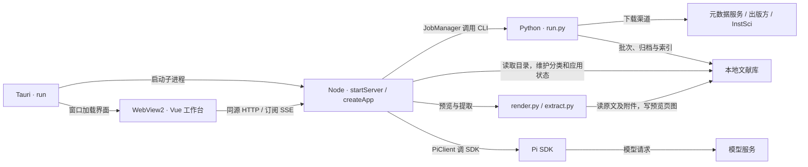

# Zhiyue 架构

## 1. 系统概览

Zhiyue 是面向个人研究者的 Windows 桌面文献工作台。用户可导入本地 PDF，按 DOI 或题名获取论文，浏览原文与笔记，或带着所选论文和附件向 Pi Agent 提问。应用生成带固定 L 编号的归档、来源记录、文献索引、阅读标记和聊天记录。PDF 渲染与核验使用本机 Python 和 Poppler。联网下载由文献工具访问元数据服务、出版方及机构渠道，问答由 Pi SDK 访问用户配置的模型服务。更新由桌面壳访问配置的更新源。操作说明见 [项目 README](README.md) 和 [桌面界面与本地服务](app/web/README.md)。

## 2. 代码地图

1. 本机构建后运行 [start-desktop.cmd](start-desktop.cmd)，源码调试用 `npm run desktop:dev`。Tauri 的 `main → run` 注册窗口、托盘、单实例与更新插件，再调用 `spawn_sidecar`。打包版从随包资源定位 Node，调试版从本机 PATH 查找 Node。[启动命令](package.json) · [Rust 入口](app/desktop/src-tauri/src/main.rs) · [Tauri 进程管理](app/desktop/src-tauri/src/lib.rs)
2. `startServer` 初始化文献库，在 `127.0.0.1` 的系统分配端口上监听，通过标准输出的 `ZHIYUE_URL=` 交接地址。Tauri 收到地址后导航到 `/`，由 Node 提供 `public/index.html` 和 `/js/app.js`。启动超时或握手前进程退出会在启动页显示错误；握手后子进程意外退出也会回到启动页显示原因。[Node 入口](app/web/src/server.ts) · [启动页](app/desktop/frontend/index.html) · [挂载页](app/web/public/index.html)
3. `mountWorkspace` 挂载 Vue 主界面，调用 `workspace.start` 拉取文献、会话和任务，并用 `EventSource` 订阅 `GET /api/events`。[Vue 入口](app/web/frontend/main.ts) · [界面状态](app/web/frontend/lib/workspace.ts)

| 要改的内容 | 从这里读 |
| --- | --- |
| 窗口、托盘、启动、运行中故障与退出 | `run`、`resolve_launch`、`spawn_sidecar`、`watch_sidecar` 和 `stop_sidecar` 管理 Tauri 窗口与 Node 子进程：关闭窗口隐藏到托盘，握手失败或握手后崩溃在启动页显示原因，退出和更新前终止 Node 进程树，作业对象在桌面进程被强制结束时兜底。更新由 `check_updates` 处理。完整状态见“桌面进程的生命周期”。[lib.rs](app/desktop/src-tauri/src/lib.rs) · [update.rs](app/desktop/src-tauri/src/update.rs) |
| 面板结构、表单、选择状态、样式 | `Workspace.vue` 装配各面板，`createWorkspace` 持有响应式状态并消费 HTTP/SSE。PDF 阅读器的页节点与缩放由 `createReader` 管理。[Workspace.vue](app/web/frontend/Workspace.vue) · [workspace.ts](app/web/frontend/lib/workspace.ts) · [reader.ts](app/web/frontend/lib/reader.ts) · [styles.css](app/web/public/css/styles.css) |
| API、附件、静态资源与事件 | `createApp` 装配 `Library`、`JobManager` 和 `AssistantService`，集中注册 `/api/` 路由。`checkRequest` 校验本机请求，`emit` 向 SSE 连接推送任务和聊天事件。[server.ts](app/web/src/server.ts) |
| 文献列表、分类、阅读标记、PDF 预览 | `Library.getLibrary` 将索引、分类目录、笔记与用户阅读状态组合成界面数据。`safeFile` 校验可读文件，`previewPaper` 调用 `render.py` 并缓存页图和文字层。[library.ts](app/web/src/lib/library.ts) · [preview.ts](app/web/src/lib/preview.ts) · [render.py](app/web/src/lib/render.py) |
| 导入、下载、归档 | `JobManager` 管理排队、日志和子进程。`run.py:main` 也供独立 CLI 使用，派发批次、渠道、核验与归档操作。新增下载渠道从 `workflow.download` 和 `providers/` 入手，编号与版本规则在 `archiving.archive`。[jobs.ts](app/web/src/lib/jobs.ts) · [run.py](app/downloader/run.py) · [workflow.py](app/downloader/workflow.py) · [归档逻辑](app/downloader/archiving.py) · [CLI 说明](app/downloader/README.md) |
| 助手消息、文献工具、模型与密钥 | `ChatService` 持有聊天、活动回答和草稿。`AssistantService` 注册 `dynamicTools` 并提供 Pi 设置接口（模型、密钥、思考强度、上下文压缩）。`PiClient` 在 Node 进程内加载 SDK、管理模型和会话，并把 SDK 事件转成应用事件（正文与推理增量分开）。[chat.ts](app/web/src/lib/chat.ts) · [assistants.ts](app/web/src/lib/assistants.ts) · [pi.ts](app/web/src/lib/pi.ts) |
| 界面状态（上次会话、当前文献、栏宽） | `UiStateStore` 读写 `.zhiyue/data/ui.json`，`GET /api/ui` 读取、`PATCH /api/ui` 按字段白名单更新；`initializePanelResizing` 接收 `widths` 并通过 `onSave` 回报。[uiState.ts](app/web/src/lib/uiState.ts) · [layout.ts](app/web/frontend/lib/layout.ts) · [server.ts](app/web/src/server.ts) |

依赖图中的箭头表示启动、调用或文件读写。应用状态随文献库存放，Pi 的全局模型与密钥配置使用本机 Pi 配置目录。[文献库布局](app/web/src/lib/paths.ts) · [PiClient.start](app/web/src/lib/pi.ts)

## 3. 核心流程

### 桌面进程的生命周期

桌面版由 Tauri 外壳和随包 Node 本地服务两部分组成。窗口、托盘和退出由外壳负责，文献库、任务和聊天都在 Node 进程内；两者只通过标准输出的一行握手地址和本机 HTTP/SSE 连接。

**启动与握手**

- 安装版从 `resources/runtime/` 定位 `node.exe` 和 `web/src/server.ts`，库路径优先取 `LITERATURE_LIBRARY`，否则取系统“文档”目录下的 `Zhiyue/library`；调试版用 PATH 中的 Node 和项目源码。`start-desktop.cmd` 会显式覆盖库路径和 Python。
- Node 在 `127.0.0.1` 的系统分配端口监听，并通过标准输出写入 `ZHIYUE_URL=` 行；外壳解析后导航主窗口。
- 30 秒（120 × 250 ms）内没有收到握手，或进程在握手前退出，外壳会终止子进程并在启动页显示错误；握手前退出时附上 stderr 最后 12 行。

**运行中故障**

- 握手后每秒调用一次 `Child::try_wait`。子进程意外退出且不处于正常退出流程时，窗口导航回启动页，显示退出码和 stderr 最近输出，提示用户从托盘退出后重新打开。
- 不自动重启：避免在库损坏、运行时缺失或端口异常时反复拉起。检测间隔约 1 秒，检测后再等启动页导航完成才写入错误，合计约 2 秒；在这之前界面可能先表现为 SSE 断开、8 秒轮询的状态检查失败，触发刷新时文献列表显示“加载失败”和“重新连接”。服务已停止时“重新连接”不会成功。
- 窗口隐藏到托盘时同样会更新错误页，重新显示窗口即可看到。

**退出处理**

- 关闭窗口只隐藏到托盘，Node 和正在运行的任务继续。
- 托盘“退出”调用 `app.exit(0)`，`RunEvent::Exit` 执行 `stop_sidecar`：先置位退出标志，避免崩溃监控误报，再用 `taskkill /PID <pid> /T /F` 终止 Node 进程树，最后以 `kill` 和 `wait` 兜底。更新安装前由 `on_before_exit` 调用同一函数，安装完成后由 Tauri 重新启动应用。
- 由于使用 `/F` 强制终止，即使托盘正常退出，Node 的 `jobs.close()`、`SIGTERM` 收尾和 Python 侧的事务收尾都不会执行；库写锁由操作系统在进程结束时释放，正在运行或排队的任务在下次启动标为中断。
- 强制结束桌面进程（任务管理器、注销、外壳崩溃）不会执行 `stop_sidecar`；Windows 作业对象设置 `KILL_ON_JOB_CLOSE`，桌面进程结束时由内核一并终止 Node 及其子进程。
- 任务中断因此不依赖退出时写状态：下次启动由 `JobManager` 读取 `.zhiyue/data/jobs.json` 并标为失败，流式聊天标为中断，归档按事务日志恢复。

**任务重启处理**

- 启动时读取 `.zhiyue/data/jobs.json`，把 `running` 和 `queued` 任务改为 `failed`，错误为“进程重启，任务已中断；请检查批次后手动续跑”；日志保留最后 10 万字符并脱敏。
- 排队任务不自动重放：没有执行记录，重放会脱离批次台账。用户需要检查批次后重新提交或续跑。
- 归档的 `prepared` 事务不自动修复：先按“归档事务的证据与恢复”核对现场，再用 `run.py repair` 续跑；已预留的 L 号不会重复分配。

**已知限制**

- 运行中崩溃没有自动重启入口，只能托盘退出后重新打开。
- 本地服务用系统分配端口，页面 origin 每次启动都会变化，因此界面状态（上次会话、当前文献、栏宽）不存浏览器 `localStorage`，改存 `.zhiyue/data/ui.json`。桌面壳在创建窗口前删除旧端口遗留的 `Local Storage` 目录（`purge_legacy_storage`，写入 `legacy-local-storage.purged` 标记后不再重试）；`UiStateStore` 每次读写先重读磁盘，两个实例交错写入时各字段不会互相覆盖。
- 作业对象只保证 Node 及其子进程随桌面进程结束，不保证任务状态和库写锁优雅落盘。
- 强制终止可能留下 `.zhiyue/tmp/` 下的临时文件；正式归档物以事务日志、来源记录和 README 为准，临时文件不参与判定。真实安装版上的验收步骤见[桌面进程验收清单](app/desktop/桌面进程验收.md)。

### 本地 PDF 从导入到出现在列表

1. `ImportPaperDialog.submit` 校验书目表单和核对勾选，逐个调用 `workspace.uploadFile`。`POST /api/uploads` 校验扩展名、大小和 PDF 文件头，把内容写到 `.zhiyue/data/uploads/` 并在 `.zhiyue/data/uploads.json` 登记，返回上传 ID。随后 `workspace.importPdfs` 发 `POST /api/library/import`，携带上传 ID、书目信息和分类。服务端按 ID 查找已登记文件。[导入对话框](app/web/frontend/components/ImportPaperDialog.vue) · [workspace.ts](app/web/frontend/lib/workspace.ts) · [server.ts](app/web/src/server.ts)
2. `JobManager.startLocalImports` 检查分类、上传位置和元数据，对当前批次和索引记录中的主文件做 SHA-256 查重。分类不存在时在提交任务前按编号规则创建；`import` 只接受已存在的分类目录。部分重复时跳过对应项，全部跳过时返回 409。`_enqueue` 在 `.zhiyue/data/jobs.json` 持久化任务，接口以 202 返回 `{ job, skipped }`。后台队列顺序运行 `import → 每项 attach、review --accept-identity → 整批 archive`。身份确认来自前端勾选，提交载荷没有单独的确认字段，后台按此入口传入人工身份确认参数。[jobs.ts](app/web/src/lib/jobs.ts) · [server.ts](app/web/src/server.ts) · [导入和查重测试](app/web/test/jobs.test.ts)
3. `run.py:main` 按批次加锁。`workflow.ingest` 把候选放到 `.zhiyue/tmp/`，用 `validation.verify` 检查身份、解析和首末页渲染，将结果写进 `.zhiyue/batches/<批次>/下载状态.json`。`archiving.archive` 在批次锁内取库写锁，重新读取批次台账，检查身份、全页解析、首末页渲染及哈希，分配或复用 L 编号，保存原字节和同名 `.来源.json`，更新文献库 README、批次及由 `library.build` 生成的 `.zhiyue/catalog/文献索引.json` 等目录文件。分类目录缺失时停止并提示修复台账，不再自动创建。未通过项留在批次，供人工处理或续跑。归档涉及多个文件，按 PDF → 来源记录 → README → 批次台账 → 派生索引的顺序写入；事务日志的 `prepared`/`committed` 语义和恢复依据见下文“归档事务的证据与恢复”。[run.py](app/downloader/run.py) · [workflow.py](app/downloader/workflow.py) · [validation.py](app/downloader/validation.py) · [batches.py](app/downloader/batches.py) · [archiving.py](app/downloader/archiving.py) · [索引构建](app/downloader/library.py)
4. `_enqueue` 从批次重新统计 `job.result.counts`。终态任务事件使服务侧 `Library.refresh` 清理缓存。导入对话框轮询 `GET /api/jobs/:id` 并重新读取 `GET /api/library`，通用工作区也处理 SSE 任务更新；SSE 只负责实时推送，断线后由轮询和 `GET /api/downloads` 补查已知任务，见下文“事件推送、断线恢复与停止”。以 `counts.archived` 判断归档数量，`completed` 仅表示命令流程结束。部分失败要查步骤日志与批次台账。[jobs.ts](app/web/src/lib/jobs.ts) · [server.ts](app/web/src/server.ts) · [导入对话框](app/web/frontend/components/ImportPaperDialog.vue) · [workspace.ts](app/web/frontend/lib/workspace.ts)

### Pi 问答从发送到保存结果

1. `Composer` 提交给 `workspace.sendMessage`，无会话时先 `POST /api/chats`，再 `POST /api/chats/:id/messages`。斜杠命令走同一套上下文：`POST /api/chats/:id/commands` 与 `/messages` 都携带 `paperIds`、`activePaperId` 与 `pdfPage`，由 `normalizePaperContext` 在 HTTP 入口统一校验（仅接受 `L\d+`、最多 6 篇、页序为正整数），命令路径同样把选中范围写回会话。`ChatService.send` 按 chat ID 限制同一会话的活动回答，提交时保存用户消息及占位回答到 `.zhiyue/data/pi/chats.json`，并立即启动后台处理。HTTP 202 表示消息已接收，回答由异步事件返回。[Composer.vue](app/web/frontend/components/Composer.vue) · [workspace.ts](app/web/frontend/lib/workspace.ts) · [server.ts](app/web/src/server.ts) · [chat.ts](app/web/src/lib/chat.ts)
2. `ChatService.run` 新建或恢复 SDK 会话，保存关联的 `threadId`。SDK 会话文件位于 `.zhiyue/data/pi-sessions/`。`run` 用 `Library.getPaper` 读取选中文献的索引信息，提示里的每条记录带编号、题名、版本、原文路径、笔记与页数；`activePaperId` 命中的那条标注 `当前打开: true` 与 `阅读页`，提示正文再点明“这篇”指该文献、读取原文用 `read_paper_pages` 并先读当前页与首末页。`run` 用 `extractFile` 提取非图片附件的内容。图片由 `PiClient.runTurn` 读取并按模型能力附加到 `session.prompt`。需要读取论文正文时，SDK 工具经 `PiClient.callTool → ChatService.serverRequest` 进入 `read_paper_pages`，并通过 `Library.safeFile` 定位原文。模型服务会收到文献索引、附件内容及工具实际返回的正文片段；提示中还有库根、选中文献和附件的本机绝对路径。选中只是初始提示，读取工具可访问任何已索引的 L 编号。工具触发的下载直接入队并在自动核验后归档，笔记只生成草稿。[chat.ts](app/web/src/lib/chat.ts) · [pi.ts](app/web/src/lib/pi.ts) · [server.ts](app/web/src/server.ts) · [数据外发范围](#模型上下文与数据外发)
3. `PiClient.runTurn` 把 SDK 消息增量和结束状态转成通知。`ChatService.notification` 在内存更新增量，经 `GET /api/events` 发送 `delta`。消息或回答完成时写入聊天记录并推送 `message`。`createWorkspace` 内的 `receive` 合并事件，`syncChat` 用 HTTP 补查状态。停止请求进入 `ChatService.interrupt`，调用 SDK 的 `abort`。若轮次仍在启动，则等 ID 返回再中断。未配置模型或生成失败时，`finish` 记录失败状态。停止只作用于本轮模型调用，已入队任务继续执行，见下文“事件推送、断线恢复与停止”。[pi.ts](app/web/src/lib/pi.ts) · [chat.ts](app/web/src/lib/chat.ts) · [workspace.ts](app/web/frontend/lib/workspace.ts) · [会话与停止测试](app/web/test/chat.test.ts) · [Pi 适配测试](app/web/test/pi.test.ts)
4. 如果模型调用 `draft_note`，`createNoteDraft` 先把草稿存在会话并发送预览事件。用户在界面选择保存或丢弃后，客户端调用 `POST /api/note-drafts/:id`，由 `resolveNoteDraft` 处理。保存时用独占创建写入 `notes/`，同名时另加序号。工作区随后刷新相关笔记。已保存的笔记在阅读区可删除：`POST /api/notes/delete` 经 `Library.deleteNote` 把文件移到 `.zhiyue/trash/notes/`（带时间戳前缀，不直接抹除），并返回刷新后的索引。[chat.ts](app/web/src/lib/chat.ts) · [library.ts](app/web/src/lib/library.ts) · [server.ts](app/web/src/server.ts) · [草稿测试](app/web/test/chat.test.ts)

### 事件推送、断线恢复与停止

**推送与补查**

- `GET /api/events` 是单向广播：连接建立时先发 `connected`（含待处理审批快照），之后推送 `delta`、`message`、`activity`、`approval`、`approvalResolved`、`noteDraft`、`noteDraftResolved`、`status` 和 `job`，每 20 秒写一个 keepalive 注释。流里没有事件 ID、断线重放或 `Last-Event-ID` 处理，断线期间的事件不会补发。[server.ts](app/web/src/server.ts) · [chat.ts](app/web/src/lib/chat.ts)
- 恢复靠 HTTP 补查：`onopen` 重新 `loadStatus` 并 `syncChat` 当前会话；`onerror` 只把 `eventsOpen` 置 false，由 8 秒轮询接管（`document.hidden` 时跳过）。轮询每次拉状态，会话在断线或正在生成时补查，`state.jobs` 中仍活跃的任务逐个 `GET /api/jobs/:id`。`syncChat` 用 HTTP 结果覆盖消息状态，但保留 SSE 已收到且更长的正文，以及 HTTP 尚未返回的消息。[workspace.ts](app/web/frontend/lib/workspace.ts)
- 断线期间不发新消息：`canSend` 要求 `eventsOpen`。已受理的轮次在服务端继续，回答完成写入 `.zhiyue/data/pi/chats.json`，重连或刷新后由 `syncChat` 读回最终文本；丢失的 `delta` 只影响过程显示。轮询只覆盖前端已知任务，断线期间由工具新建的任务要等 `GET /api/downloads`（启动时或进入“下载任务”）才出现。这是当前恢复范围的上界。[workspace.ts](app/web/frontend/lib/workspace.ts) · [server.ts](app/web/src/server.ts)

**停止的作用范围**

- `POST /api/chats/:id/interrupt` 进入 `ChatService.interrupt`：标记本轮 cancelled 并调用 SDK 的 `turn/interrupt`；轮次仍在 `turn/start` 时等 turn ID 返回后再中断；本地没有活动轮次时直接记为 `interrupted`。作用只限模型轮次，轮次结束时 `finish` 按 `turn/completed` 记录终态（中止为 `interrupted`），并拒绝该会话的待审批项。[chat.ts](app/web/src/lib/chat.ts) · [pi.ts](app/web/src/lib/pi.ts)
- 已入队或正在运行的下载不受停止影响：`JobManager` 的顺序队列继续执行，`job` 事件继续推送，前端继续轮询。目前没有取消任务的接口，停止后仍可能出现下载、核验和归档写入；归档按事务日志提交，不因停止回退。[jobs.ts](app/web/src/lib/jobs.ts) · [server.ts](app/web/src/server.ts)
- 只有进程退出（托盘退出以 `taskkill /T /F` 结束 Node）才中断任务：运行中和排队任务在下次启动标为 `failed`，排队任务不自动重放；流式回答在服务重启时标为 `interrupted`。后台是否仍在工作，以任务中心状态为准，不能从问答是否停止推断。[桌面进程的生命周期](#桌面进程的生命周期) · [jobs.ts](app/web/src/lib/jobs.ts)

## 4. 架构约束与决策

| 修改时要守住的边界 | 现有保证与验证入口 |
| --- | --- |
| 桌面壳管理进程与窗口，Vue 通过本地 HTTP/SSE 使用业务能力 | Tauri 的 `run` 注册插件与窗口逻辑。主业务接口集中在 `createApp`，由本地服务校验 Host、Origin、跨站标记与请求类型；这些校验只排除浏览器跨源和域名重绑定，不构成登录鉴权，本机任意进程可直接调用。资料读取经 `Library.safeFile` 和真实路径检查，信任假设见下文“本机接口的信任边界”。变更文件接口时保持索引和目录边界。[Tauri 权限](app/desktop/src-tauri/capabilities/default.json) · [server.ts](app/web/src/server.ts) · [HTTP 测试](app/web/test/server.test.ts) · [资料边界测试](app/web/test/library.test.ts) |
| 添加论文走 Python 归档，阅读标记走 Node | `archive` 在批次锁内取库写锁，保留原文和版本，编号在这里分配。`library.build` 从文献库 README 与来源记录生成索引。`Library.updatePaper` 只接受阅读状态和收藏字段，排队写入 `.zhiyue/data/reading.json`。分类改名也由 Python 文献工具在库写锁下移动目录并同步引用、批次台账和索引；Node 只做请求校验。相关迁移须按团队约定一次性切换。[archiving.py](app/downloader/archiving.py) · [categories.py](app/downloader/categories.py) · [library.ts](app/web/src/lib/library.ts) · [归档与并发编号测试](app/downloader/tests/test_workflow.py) · [分类事务测试](app/downloader/tests/test_categories.py) · [协作约定](AGENTS.md) |
| 任务队列、批次台账与归档文件是三类状态 | Node 的 `JobManager` 对应用任务串行调度并持久化，Python CLI 对批次操作加锁，归档和分类结构改动共用库写锁。进程重启时，Node 端排队中和运行中的任务会被标为失败并提示查看批次后续跑。同一库的写入范围、锁顺序和恢复规则见下文“文献库写入与并发”。[jobs.ts](app/web/src/lib/jobs.ts) · [run.py](app/downloader/run.py) · [categories.py](app/downloader/categories.py) · [归档锁](app/downloader/archiving.py) |
| 模型能力由文献工具清单限定，正式笔记由用户定稿 | `AssistantService` 注册 `dynamicTools`，`PiClient.createSession` 只把这六项文献工具与 `read_skill` 交给 SDK；扩展加载器返回空，技能只从库内 `.zhiyue/skills` 扫描，系统提示列出名称与描述，正文按需读取。斜杠命令分两层：`/help`、`/skills`、`/compact` 由 `ChatService.command` 直接回执或调用 Pi 的 `thread/compact`，不进入模型；`/skill:<名称>` 与 Pi 的技能命令同格式展开后作为普通用户回合发送，聊天记录只保留单行指令。新增工具在 `serverRequest` 校验输入后复用已有服务。上下文与外发范围见“模型上下文与数据外发”，各工具确认点见“文献工具的影响与确认点”：工具触发的下载在同一任务里自动归档，正式笔记仍由草稿确认端点写入。流式终态和停止时序有测试。[assistants.ts](app/web/src/lib/assistants.ts) · [pi.ts](app/web/src/lib/pi.ts) · [chat.ts](app/web/src/lib/chat.ts) · [会话与工具测试](app/web/test/chat.test.ts) |

仓库中未找到独立 ADR。表中记录的是当前代码、测试或维护约定可确认的边界。当前由桌面 WebView 通过本机 HTTP 发起请求、以 SSE 接收异步事件；这是实现现状，不代表已确认长期保留该接口方式。保留 HTTP/SSE 的理由，以及接口是否只服务桌面 WebView 或面向其他本机客户端，仍待维护者确认。

### 本机接口的信任边界

服务绑定在 `127.0.0.1` 的系统分配端口，地址经标准输出交给桌面壳，窗口导航到该地址，页面与服务同源。业务接口没有令牌、会话或 CSRF 令牌，也不检查用户是否在场；`checkRequest` 只做浏览器侧的来源与请求类型校验。

| 检查项 | 实际做法 | 挡住什么 | 挡不住什么 |
| --- | --- | --- | --- |
| 监听地址 | `listen(0, '127.0.0.1')` 由系统分配端口，`ZHIYUE_URL=` 握手行交给 Tauri，窗口导航到该地址 | 局域网和远程主机 | 同机任意进程；回环端口可扫描后直接访问 |
| Host | 仅接受 `localhost`、`127.0.0.1`、`[::1]`，可带端口 | 域名解析到回环的 DNS 重绑定 | 自填请求头的本机客户端 |
| Origin | 存在时必须等于 `http://<Host>` | 其他网站发起的跨源请求 | 不带 Origin 的 curl 或原生程序 |
| Sec-Fetch-Site | 值为 `cross-site` 时拒绝 | 部分浏览器跨站请求 | 非浏览器客户端 |
| 请求类型 | 非 GET/HEAD 必须为 `application/json`，`/api/uploads` 例外（原始字节加 `x-filename`） | 跨站简单表单提交 | 已能发 JSON 的本机程序 |
| 身份与在场 | 无鉴权、无会话、无二次口令 | — | 同机其他用户、恶意进程、被注入的 WebView |

信任集合因此是“本机、单用户、没有对抗进程”；同机其他用户和恶意进程不在防护范围内，和“两台机器或网络盘共享同一库不支持”是同一前提。能连上该端口的本机程序可以读取索引登记的原文、笔记与成果，提交导入和下载，改名分类，保存或清除模型密钥，确认笔记草稿。桌面侧 `capabilities/default.json` 只授予 `core:default`，没有启用文件、HTTP 或 shell 插件权限；响应另带 `nosniff`、`no-referrer` 与 CSP。这些都不改变“本机进程可调用”的结论。

新增接口要按“任何本机进程都能调用”评估：Host、Origin 校验不构成权限判断；写入范围仍由 `Library.safeFile`、分类参数校验和各服务自身的输入校验限定。[server.ts](app/web/src/server.ts) · [Tauri 权限](app/desktop/src-tauri/capabilities/default.json) · [进程与握手](app/desktop/src-tauri/src/lib.rs) · [HTTP 测试](app/web/test/server.test.ts)

### 模型上下文与数据外发

模型只经由 Pi SDK 访问用户配置的服务商。进入上下文的本机内容如下，其余资料须由工具实际读取才会离开本机。

| 内容 | 来源与范围 | 发送时机 |
| --- | --- | --- |
| 系统提示 | `ChatService.instructions`，含文献库根目录绝对路径；另附加 `<库根>/.zhiyue/AGENTS.md` 全文 | 会话建立时 |
| 选中文献 | 最多 6 篇的编号、题名、版本、`原文路径`（绝对路径）、笔记入口 | 每轮 |
| 用户问题 | 最多 5 万字符 | 每轮 |
| 图片附件 | 上传文件的原始字节，按 base64 图像块发送；模型不支持图片时报错 | 提交时 |
| 其他附件 | `extract.py` 提取的文本：PDF 未指定页时取前 8 页，单项文本上限 10 万字符；Office 取正文 XML；同时附上传文件的绝对路径 | 提交时 |
| 工具结果 | `library_search` 最多 20 条（编号、题名、年份、DOI、相对路径、笔记入口）；`read_paper_pages` 每次最多 12 页逐页文本，单次输出上限约 800 KB | 调用时 |

选中文献只决定首轮提示，不限制读取范围：`read_paper_pages` 接受任何已索引的 L 编号，库内全部文献都在模型可达范围内；会话历史中出现过的页文本会随后续轮次再次发送。PDF 原件、全库索引、其他会话内容、`~/.pi/agent` 中的凭据不会被自动发送。

模型服务由用户在 Pi 中配置，其网络、计费和留存策略取决于该服务商，应用不对发送内容做额外过滤或脱敏。本机另存两份记录：`.zhiyue/data/pi-sessions/` 的 SDK 会话文件按 Pi 的格式保存消息与工具结果；`.zhiyue/data/pi/chats.json` 保存用户文字、回答和笔记草稿正文，附件的记录只有 id、名称、类型和大小，不含提取文本或图片字节。[chat.ts](app/web/src/lib/chat.ts) · [pi.ts](app/web/src/lib/pi.ts) · [附件提取](app/web/src/lib/extract.py)

### 文献工具的影响与确认点

网页会话只注册 `dynamicTools` 六项文献工具与 `read_skill`，`createAgentSession` 的 `tools` 也只列这些；斜杠命令是网站的输入层，`/help`、`/skills` 只生成回执消息，`/compact` 复用 Pi 会话压缩（写回同一会话文件），`/skill:<名称>` 仅把库内技能正文放进本轮提示，都不新增模型可达的写入入口；资源加载器返回空的扩展、提示和主题，技能仅限文献库 `.zhiyue/skills` 内的 Markdown/文本，Pi 的 shell 与任意文件写入工具没有启用。模型对磁盘的影响只经过下表入口。工具调用只在活动会话内响应，单次调用 120 秒超时。

| 工具 | 可达范围 | 影响 | 确认 |
| --- | --- | --- | --- |
| `library_search` | 全库索引 | 只读 | 无 |
| `read_paper_pages` | 任意已索引 L 编号，每次 1 至 12 个物理页 | 只读原文，45 秒超时，输出上限约 800 KB | 无 |
| `download_papers` | 新批次，单次 1 至 500 条 | 联网后入队 `import → download → archive`，写 `papers/`、README、来源记录与批次 | 无二次确认；归档前由 `validation.verify` 自动比对首页题名与 DOI 或第一作者，未通过项留在批次 |
| `continue_download_batch` | 已有批次 | 入队 download、verify、archive、ieee、collect | 无；`submit` 只对 ieee 生效 |
| `get_download_status` | 单个任务 | 只读任务与日志 | 无 |
| `read_skill` | 库内 `.zhiyue/skills` | 只读技能目录内的 `.md`/`.txt` | 无 |
| `draft_note` | 当前会话 | 只写 `chats.json` 草稿并推送预览 | 两步：用户点击保存后 `POST /api/note-drafts/:id` 才写入 `notes/`，独占创建、同名加序号、不覆盖 |

`requestApproval` 与 `requestUserInput` 的转发通道存在，请求会显示在右侧、默认拒绝；当前工具不触发这类审批，不能当作逐工具确认。网页端的其他写入入口（上传、导入、分类改名、阅读标记、笔记删除、模型密钥、审批）不在工具表内，调用即生效，由上面的信任边界兜底。

与网页导入的差别在身份确认：导入对话框要求用户勾选已核对题名与作者，后台执行 `review --accept-identity`；模型工具发起的下载走自动核验后直接归档，没有这一勾选。[chat.ts](app/web/src/lib/chat.ts) · [jobs.ts](app/web/src/lib/jobs.ts) · [身份核验](app/downloader/validation.py) · [会话与工具测试](app/web/test/chat.test.ts)

### 文献库写入与并发

共享写入指 `README.md`、`.zhiyue/catalog/*`、批次台账中的分类路径，以及 `papers/` 下的分类目录本身。它们只由 Python 文献工具在库写锁 `.zhiyue/library.write.lock` 下修改。Node 的任务队列只保证同一进程内的提交顺序，不替代文件锁。

锁按固定顺序获取：批次命令先取 `.zhiyue/batches/.<批次>.lock`，需要修改共享状态时再取库写锁；归档在批次锁内完成编号、复制、来源记录、README 和索引更新。分类改名只取库写锁，对批次台账的 `category` 使用写入前比对（CAS），不反向等待批次锁，避免与归档形成等待环。新建分类只做一次独占 `mkdir`，不写 README 或索引；导入前由 Node 按编号规则创建分类，`import` 和 `archive` 只接受已存在的分类目录。

| 场景 | 行为 |
| --- | --- |
| 归档运行中改名 | 改名取锁最多等待 5 秒，取不到锁返回 409；任务结束后重试 |
| 改名运行中归档 | 归档取锁最多等待 20 秒；超时任务失败并保留批次，可续跑 |
| 改名与排队中的导入/下载 | 改名不等待尚未开始的队列；任务开始后分类已改名会失败，需重新提交 |
| 两个归档或两个改名 | 库写锁串行；编号在锁内分配，不重复 |
| 新建分类与归档/改名 | 新建只做独占 `mkdir`；编号冲突返回 409 |
| 阅读标记、预览、列表 | 只读或只写 `reading.json`，不取库写锁 |
| 运行中用资源管理器移动或删除文件 | 不支持；操作失败并保留事务记录 |
| 两台机器或网络盘共享同一库 | 不支持；锁和路径检查按本机假设 |

读请求不取库写锁；改名进行中列表或预览可能短暂看到旧路径，改名返回后界面刷新，预览失败可重试。

### 分类改名的同步范围

| 位置 | 同步内容 | 方式 |
| --- | --- | --- |
| `README.md` | 表格链接、正文路径、`<...>` 和百分号编码形式 | 重写；写入前比对读取时的字节 |
| `papers/**/*.来源.json` | `当前路径` 等路径字段 | 结构化前缀替换 |
| `papers/**`、`notes/`、`synthesis/`、`outputs/` 的文本 | 旧路径文本 | 幂等替换；超过 4 MB 的文件跳过 |
| `.zhiyue/batches/*/下载状态.json` | `category` 及子分类前缀 | CAS 重写 |
| `.zhiyue/tmp/*/archive_backups/*_归档事务.json` | `record.file`、`record.source_record` | 前缀替换，供归档恢复使用 |
| `.zhiyue/catalog/*` | `file`、`source_record`、版本路径 | 由 `library.build` 重建；已有同名文件的哈希保留 |
| `reading.json`、临时目录、历史备份、预览缓存 | 不随改名变化 | 不改 |

执行顺序固定为“目录 → README → 源文件 → 台账和归档事务 → 派生索引”。派生文件可以重建，所以放在最后；源文件先改，失败时只需重跑后续步骤。

### 归档事务的证据与恢复

归档跨多个文件写入；JSON、来源记录和 README 用临时文件替换，PDF 复制直接写目标文件，崩溃可能留下哈希不符的半截文件，恢复时按冲突停止。需要判断的是多个文件之间的阶段差。`committed` 只表示不可重建的归档写入已经完成：PDF 字节、`.来源.json`、README 的 L 行和批次台账。`下载结果.md`、`待处理清单.csv` 与 `.zhiyue/catalog/*` 是派生视图，允许滞后，恢复时重建，不能作为提交证据。

| 落盘物 | 能证明 | 不能证明 | 恢复时先核对 | 可否重建 |
| --- | --- | --- | --- | --- |
| `papers/**/*.pdf` | 该 L 号的正本字节已落盘；与事务记录、来源记录、台账的 SHA-256 一致时内容完整 | 元数据、README 行、台账状态是否已写 | 目标存在；`sha256(dest) == record.sha256 == 批次条目.sha256`；不一致即停 | 否，唯一正本；只校验不覆盖 |
| `papers/**/*.来源.json` | 编号、路径、题录、来源、下载和归档日期、页数、字节数、哈希、核验结果、批次、下载历史 | README 行和台账是否已推进 | `文献编号`、`当前路径` 与事务记录一致；冲突即停 | 缺失时可从事务记录和批次条目补建；归档日期、下载历史不能凭空重建；存在即不覆盖 |
| `README.md` 的 L 行 | L 号已分配且在库级索引可见；主 PDF 与来源记录入口 | 台账状态；索引 JSON 是否最新 | 行存在且包含本次 `record.file`（主链接或新增版本链接）；同 L 指向无关文件即停 | 缺行可由事务记录和来源记录幂等追加；已有行、阅读标记不自动改写 |
| `.zhiyue/batches/<批次>/下载状态.json` | 条目阶段（`verified`、`archived`）、L 号绑定、下载尝试与事件历史 | PDF、来源、README 是否真的写完（可能滞后） | `literature_id`、`file` 与事务记录和来源记录一致；`archived` 才表示台账已确认 | 状态可依据归档物回填；尝试和事件历史不可重建 |
| `下载结果.md`、`待处理清单.csv` | 只是台账视图，没有独立证明力 | 任何提交阶段 | 不用于判断 | 是，`batches.write` 重建 |
| `archive_backups/<条目>_归档事务.json` | `prepared`：编号和目标路径已预留；`committed`：PDF、来源、README、台账均已提交 | 派生索引是否最新；用户是否已阅读 | `state` 及 `record` 的编号、路径、哈希与现场逐项比对 | 否，编号预留的唯一记录；恢复后保留 |
| `.zhiyue/catalog/*` | README 与来源记录的投影；`issues` 可暴露不一致 | 任何写入是否完成；`generated_at` 不代表提交 | 最后重建，不用来判定 | 是，`library build` 全量重建 |

库内已有相同字节但缺少 `.来源.json` 时，归档停止并提示先修复来源记录；复用已有字节不绕过来源记录检查。`archive_backups/README_*.md` 只是追加 README 前的快照，用于外部改动后的合并，不作为提交证据。

恢复时按以下顺序只读核对，再决定补写；后面的文件不能反向覆盖前面的源文件：

1. 读事务日志。没有日志的 L 号不自动补事务，只重建索引并报告。
2. 校验目标 PDF 的 SHA-256。缺失或不一致时停止，不覆盖已有目标。
3. 核对或补建 `.来源.json`。`文献编号`、`当前路径` 与事务记录不一致时停止。
4. 核对或追加 README 行。行必须包含本次 `record.file`（主链接或新增版本链接）；同 L 指向无关文件时停止。
5. 更新批次台账及其派生视图。台账已标记 `archived` 但字段冲突时停止。
6. 最后重建 `.zhiyue/catalog/*`；索引不作为恢复判断依据。

| 现场 | 判定 | 动作 |
| --- | --- | --- |
| 无事务日志，只有 PDF、README | 可能是历史归档或人工维护 | 不自动补事务；重建索引并报告后人工核对 |
| `prepared`，目标 PDF 不存在 | 复制前中断 | 重跑 `archive`，沿用记录中的 L 号和目标路径 |
| `prepared`，PDF 存在且哈希一致，来源或 README 缺失 | 复制后中断 | 补来源 → README → 台账，不重新分配编号 |
| `prepared`，PDF、来源、README 都在，台账未 `archived` | README 后中断 | 只补台账和派生视图，然后提交 |
| `prepared`，全部都在且台账已 `archived` | 只差提交 | 重写台账视图 → `committed` → 重建索引 |
| `committed`，索引缺失或过期 | 提交后中断 | 只重建索引，不改归档物 |
| PDF 哈希不符、同 L 指向无关文件、来源记录冲突 | 冲突 | 停止并报告，不覆盖、不删除 |
| `committed` 但台账未 `archived` | 旧顺序或外部改动 | 按冲突人工核对，不自动降级为 `prepared` |

### 部分失败后的修复顺序

改名开始时写 `.zhiyue/data/repairs/rename/*.json`，记录旧路径、新路径、阶段和待改文件。移动目录后立即把阶段写为 `moved`；引用和台账改完后重建索引，最后写 `done` 并删除日志。归档在复制前写 `.zhiyue/tmp/<批次>/archive_backups/<条目>_归档事务.json`；PDF、来源记录、README 行和批次台账都写完后才把状态改为 `committed`，派生索引在提交后重建。

`run.py repair` 按以下规则处理改名日志：

- 只剩新目录：从重写 README 开始继续；
- 只剩旧目录：判定未移动，结束；
- 新旧都在：停止并报告冲突，不自动删除；
- README 被外部修改：停止，提示先保存或合并，不覆盖。

归档恢复按上一节“归档事务的证据与恢复”执行。`run.py repair` 对 `prepared` 事务重跑 `archive`，最后在库写锁内重建派生索引；字节不一致、编号冲突或出现意外文件时停止并报告，不删除已有文件。`archive` 遇到缺失的分类目录会报错，不再执行 `mkdir`；目录缺失说明分类已改名或台账过期，应先修复台账。

## 5. 构建、部署与排障

- `desktop:build` 先由 `npm run build:node` 把服务端、测试与脚本编译到 `build/`，再由 Vite 从 `frontend/main.ts` 生成 `app/web/dist/app.js`；`prepare-desktop.ts` 随后准备 `resources/runtime/`，复制 Node、编译后的服务端（`build/app/web/src`）、前端产物、文献库模板和 npm 运行依赖。Tauri 的 `frontendDist` 指向桌面启动页，`bundle.targets` 配置为 NSIS，发布资源随安装包交付。插入构建步骤时同时检查构建清单、启动路径和安装布局测试。[package.json](package.json) · [Vite 配置](app/web/vite.config.ts) · [资源准备](scripts/prepare-desktop.ts) · [Tauri 配置](app/desktop/src-tauri/tauri.conf.json)
- 排查“打开了另一份库”时，查 `GET /api/status` 的 `root` 与 `python`。源码调试默认用项目内 `library/`，安装版正常从系统文档目录定位 `Zhiyue/library`，`LITERATURE_LIBRARY` 可覆盖。`start-desktop.cmd` 默认显式指向项目库并优先使用项目虚拟环境。安装包内置 Node 与 Pi SDK，Python、Poppler、curl 和机构登录环境由本机提供。更新检查依赖运行时的 `ZHIYUE_UPDATE_ENDPOINT`，安装行为受 Tauri 的更新签名配置约束。正式更新源及其访问、签名和安装行为需在发布环境核验。[resolve_launch](app/desktop/src-tauri/src/lib.rs) · [paths.ts](app/web/src/lib/paths.ts) · [本机启动脚本](scripts/start-desktop.ps1) · [更新器](app/desktop/src-tauri/src/update.rs) · [更新与签名说明](app/README.md#桌面应用)
- 本地服务在握手后退出时，窗口会回到启动页显示退出码和最后输出，但不会自动重启；托盘退出后重新打开即可。强制结束桌面进程时 Node 由作业对象一并结束，正在运行的任务在下次启动标为中断。相关边界和手工步骤见[桌面进程验收清单](app/desktop/桌面进程验收.md)。
- `app/web/` 是桌面界面与本地服务的源码目录。启动命令见 [package.json](package.json) · [本地服务入口](app/web/src/server.ts) · [界面说明](app/web/README.md)
- 从 `npm test` 的 HTTP/SSE、任务和 Vue DOM 测试定位应用行为。Python 核验和归档查 `npm run test:downloads`。`npm run test:desktop` 在已有构建产物上复制安装布局，直接启动随包 Node，覆盖空库初始化、离线归档和重启后读取。它通过 Python CLI 准备候选，再调用归档接口；由于直接启动 Node 并显式传入库路径，它不覆盖桌面壳、WebView2、握手后崩溃、强制退出和默认库路径定位，也不运行 NSIS 安装器。上述桌面行为由[桌面进程验收清单](app/desktop/桌面进程验收.md)在真实安装版上验收。WebView2、NSIS 安装操作、更新源及真实模型服务需要各自的验证。[测试命令](package.json) · [安装布局测试](app/desktop/test/first-run-import.test.ts) · [验证说明](app/web/README.md#验证与维护)

### 待维护者确认

- 本机接口是否需要令牌或会话，把“同机任意进程可调用”收敛为显式授权？
- 模型发起的下载与归档是否需要用户显式确认，而不只依赖自动身份核验？
- 正式发布的更新源由谁配置和维护，签名更新通过哪个环境验收？
